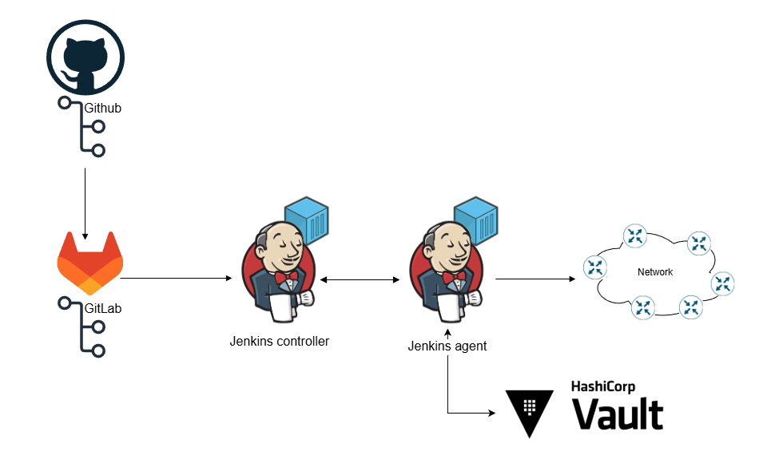

# IaC-terraform-network-cfg  

Based on [Network as Code IOS-XE](https://netascode.cisco.com/docs/start/iosxe/introduction/)  

  
*NaC: generic design*  

Grant Jenkins access to GitLab projects:  
[Create a group access token](https://docs.gitlab.com/user/group/settings/group_access_tokens/#create-a-group-access-token/)  

GitLab <-> Jenkins, webhook integration
[Configure GitLab project](https://docs.gitlab.com/integration/jenkins/)  

Add Jenkins agent as Podman container:    
Click on the new agent name to note the secret  
Execute below command on Podman server:  
```podman run -d --name agent2_podman --restart unless-stopped --init -v jenkins-agent-workdir:/home/jenkins/agent docker.io/jenkins/inbound-agent:latest -url http://jenkins.homelab.com:8080 -webSocket -secret a958e5d3aab0e68e4bfaf81915ed1d8dce20411c8e767c3b9585ec539ca00647 -name "agent2_podman"```  

> [!NOTE]
> Usefull commands:  
> podman ps       # This command is used to list the running containers  
> podman ps -a    # This command is used to show all the running and exited containers  
> podman stop <container-name> # This command stops a running container  
> podman rm <container-name>   # This command is used to delete a stopped container  


Tools:
- Github (single source of truth)
- GitLab (on-premise)
- Terraform provider for IOS-XE
- [Terraform Network-as-Code Cisco IOS-XE Module](https://github.com/netascode/terraform-iosxe-nac-iosxe)
- Terraform cloud (for Terraform state)