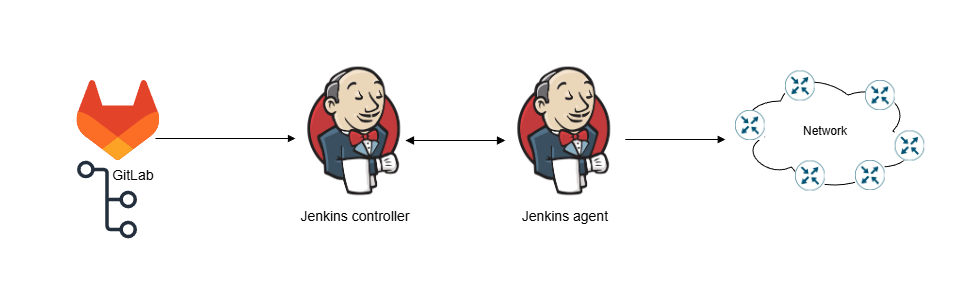

# IaC-terraform-network-cfg  

Based on [Network as Code IOS-XE](https://netascode.cisco.com/docs/start/iosxe/introduction/)  

  
*NaC: generic design*

Tools:
- Terraform provider for IOS-XE
- [Terraform Network-as-Code Cisco IOS-XE Module](https://github.com/netascode/terraform-iosxe-nac-iosxe)
- Terraform cloud (for Terraform state)